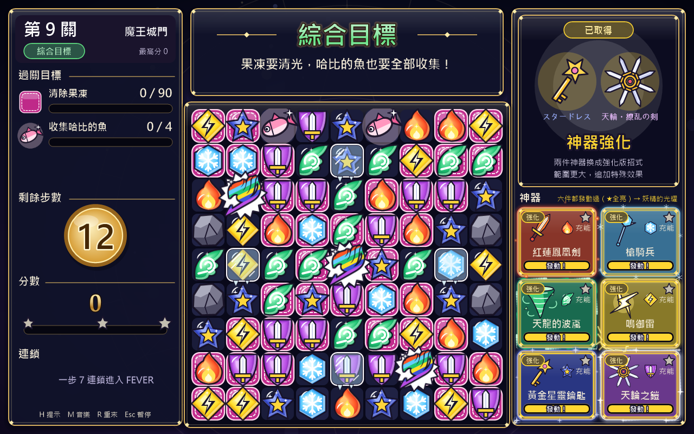
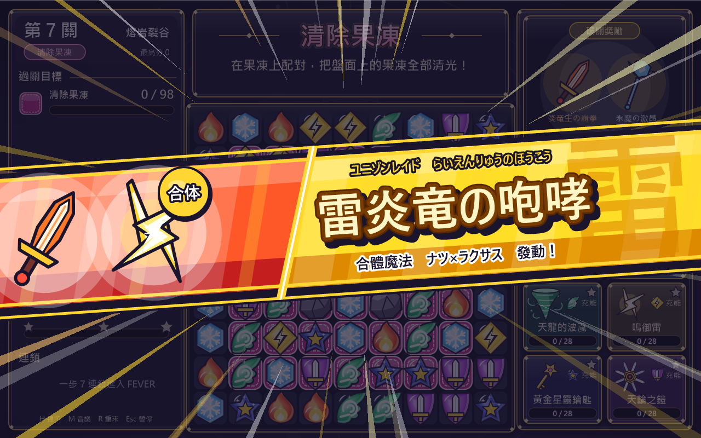
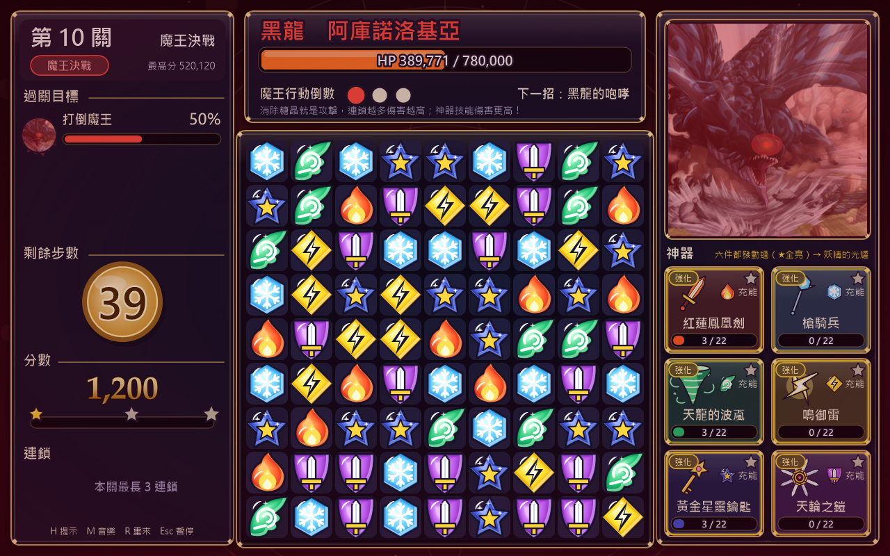
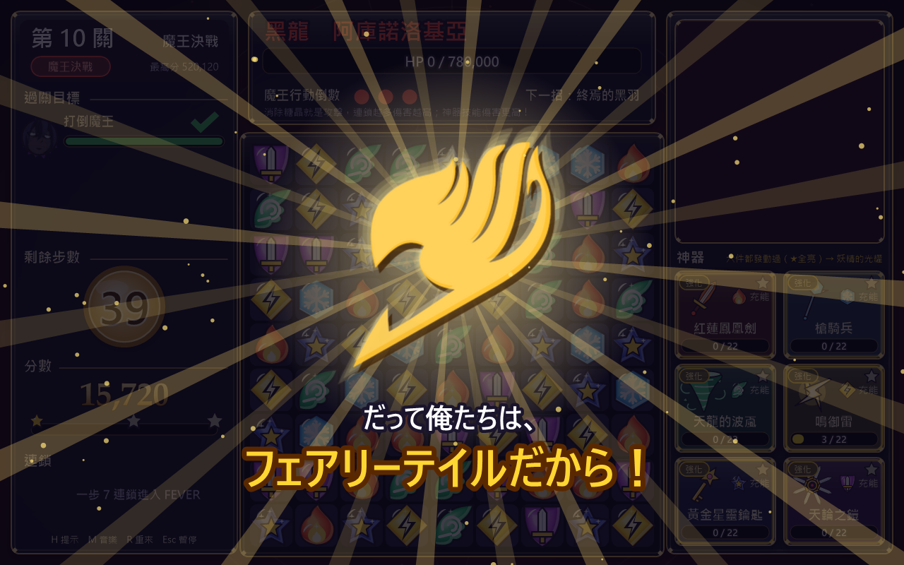

# FAIRY TAIL — 六神器與百年任務

C# Windows Forms（.NET 6）三消遊戲。畫面全部用 GDI+ 向量繪圖畫出來，音樂和圖片都包在 exe 裡，單一檔案就能在沒有網路、沒裝 .NET 的電腦上執行。



## 線上玩（免下載）

**https://kazuto0126.github.io/1142922-homework/hw05/**

電腦、手機瀏覽器都能玩（手機請橫放）。網頁版的做法見 [HW05-1142922-web](../HW05-1142922-web)。

## 下載 Windows 版

到 [Releases](../../releases) 下載 `HW05-1142922.exe`，直接執行即可（Windows 10/11 64 位元）。

## 玩法與特色

- **10 個關卡**：分數挑戰、收集掉落物（哈比的魚）、清除果凍、綜合目標，最後是魔王戰。
- **特殊糖晶**：連四個變橫斬／直斬，L、T 型變炸彈，連五個變六色公會紋章核心，消滅整種屬性。
- **六神器**：消除對應屬性的糖晶會充能，充滿後自動發動招式，卡片周圍會有屬性微光。
- **合體魔法（Unison Raid）**：搭檔的兩件神器同時充滿就合放一招，例如「雷炎竜の咆哮」。
- **妖精的光耀**：六件神器都發動過一輪後施放，打中整個盤面。
- **場地機關**：厚冰、側吹的強風（糖晶往側邊掉）、落雷、傳送門。
- **魔王戰：黑龍 阿庫諾洛基亞**：血量剩一半時從人形態龍化進入第二階段。之後的「黑龍的咆哮」要在 3.4 秒內照順序點魔法陣擋下。
- **演出**：開場動畫、展示模式（標題畫面按 D）、打倒魔王後的金色公會徽章和片尾名單。

| 合體魔法 | 魔王第二階段 | 打倒魔王 |
|---|---|---|
|  |  |  |

## 操作

| 按鍵 | 功能 |
|---|---|
| 滑鼠拖曳 | 交換糖晶 |
| H | 提示 |
| M | 音樂開關 |
| R | 重來 |
| Esc | 暫停 |
| D | 展示模式（標題畫面） |

## 建置

用 Visual Studio 2022 開啟 `HW05-1142922.sln` 直接建置執行。

發佈單一 exe：在 Visual Studio 選「建置 > 發佈」，使用 `SingleExe` 設定檔。指令列寫法：

```
dotnet publish -c Release -p:PublishProfile=SingleExe
```

自我檢查（規則測試、機器人試玩各關過關率、音量檢查）：

```
.\run-selftest.ps1
```

## 程式結構

| 資料夾 | 內容 |
|---|---|
| `Core` | 盤面、消除規則、關卡資料、遊戲流程（`Session`）、自我檢查 |
| `UI` | 視窗、各畫面、HUD、演出、向量繪圖（`Art`） |
| `Audio` | 混音器、合成音效 |
| `Assets` | 內嵌的音樂、魔王插圖、公會徽章 |

## 素材來源

《FAIRY TAIL》（妖精的尾巴）的角色、招式名稱與公會徽章版權屬於原作者真島浩與講談社；歌曲版權屬於各原權利人。本專案是非營利的課程作業同人遊戲。

- 魔王插圖：阿庫諾洛基亞龍形態（萌娘百科）、人形態（Fairy Tail Wiki）
- 妖精的光耀畫面：Fairy Tail Wiki
- 背景音樂（以 HDemucs 去除人聲）：
  - 和田光司〈Butterfly〉（數碼寶貝大冒險 OP）：標題畫面、第 7–9 關
  - 米津玄師〈ピースサイン〉（我的英雄學院 OP）：關卡地圖
  - LiSA〈crossing field〉（刀劍神域 OP）：第 1–3 關
  - fripSide〈only my railgun〉（科學超電磁砲 OP）：第 4–6 關
  - 米倉千尋〈約束の日〉（FAIRY TAIL OP14）、ReoNa〈ANIMA〉：魔王第一階段
  - 高梨康治〈FAIRY TAIL Main Theme〉：魔王第二階段
- 其餘畫面與音效皆由程式繪製、合成。
